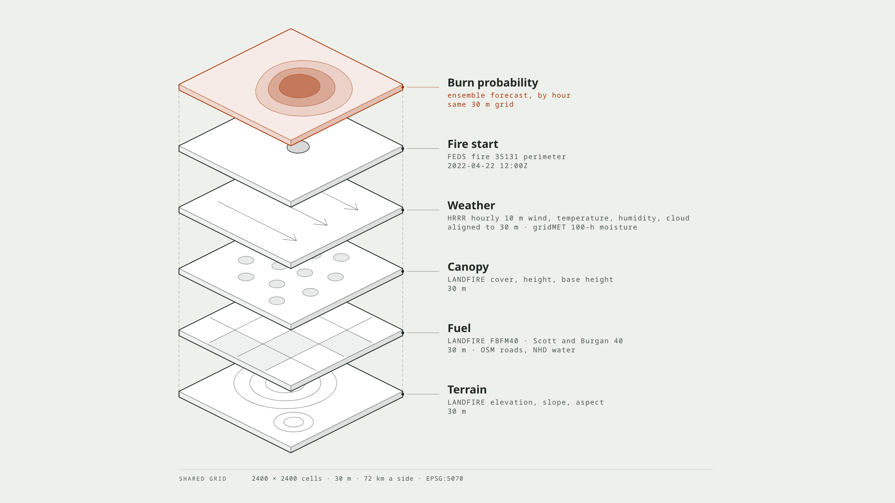
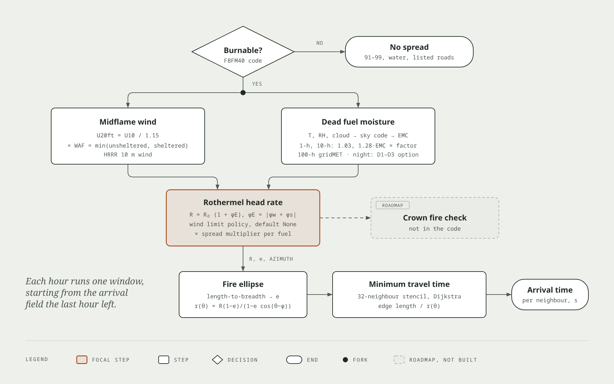
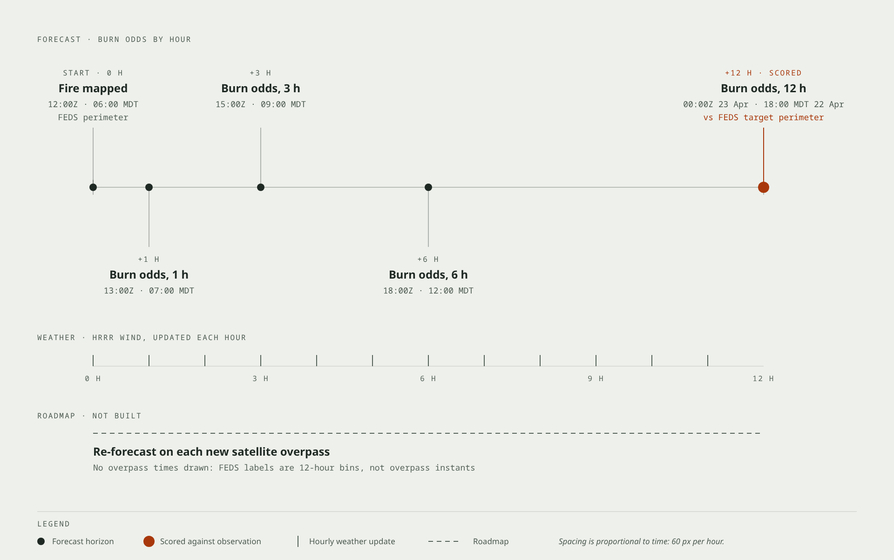

# firespread

firespread is an open wildfire spread forecast with a scorecard for New Mexico
fires. The forecast gives, for each 30 m cell of a map, the chance that the
fire reaches it by a given hour. The scorecard compares the forecast with the
fire that really happened, and with two simple reference forecasts.

The project is an entry for the HAIIC Embers to Aftermath hackathon in Santa Fe
on 2026-10-27. Its test case is the Hermits Peak and Calf Canyon fire of 2022.

## Why a scorecard

If fire managers do not know how good a forecast is, they do not use it. A scorecard
answers that question with numbers. It scores a forecast against observed fire
perimeters, and it also scores two baselines. A baseline is a forecast so
simple that any useful model must beat it. If a model loses to a baseline, the
scorecard shows that.

## Concepts

The rest of this file uses these terms.

| Term | Meaning |
|---|---|
| Perimeter | The outline of the burned area at one time. |
| Fuel model | A standard description of the vegetation that burns: its load, particle size and depth. firespread uses the 40 models of Scott and Burgan (2005). |
| Dead fuel moisture | The water content of dead grass, twigs and branches, in percent of dry weight. Classes 1-h, 10-h and 100-h hold fuel of increasing diameter. |
| Rate of spread | The speed of the fire front, in m/s. The Rothermel (1972) model gives it from fuel, moisture, wind and slope. |
| Minimum travel time | A method that grows a fire over a grid. It finds the earliest time that the fire reaches each cell, from the spread rates of its neighbors. |
| Ensemble | Many runs of the same forecast, each with slightly different inputs. firespread changes the ignition point, the wind and the fuel moisture in each run. |
| Member | One run of the ensemble. |
| Burn probability | The share of members that burn a cell by a given hour. |
| Window | One forecast period with a start perimeter and an observed end perimeter. |
| Persistence | A baseline: the fire does not move. |
| Uniform growth | A baseline: the start perimeter grows evenly in every direction, at the rate of the 12 h before the window. |

## How it works

1. Python scripts download the input data and align every layer to one grid.
   The grid has 2400 by 2400 cells of 30 m in EPSG:5070.
2. The `firespread ensemble` command runs the members in parallel. Each member
   spreads the fire hour by hour with that hour's weather.
3. The command writes one burn probability map for each forecast hour.
4. The `firespread score` command compares the maps and the two baselines with
   the observed perimeter.
5. A static web page shows the maps, the observed perimeter and the scorecard.



The input layers and the forecast share one grid. The fire start shown is the
FEDS perimeter of window w1.

### The spread model

Each member computes the rate of spread in every cell from the Rothermel
(1972) equations, as Andrews (2018) RMRS-GTR-371 documents them. The fire
spreads faster in the direction of the wind and up the slope. The model gives
an elliptical fire shape, and the spread rate in each direction comes from
that ellipse (Finney 1998). The fire moves between cells over 32 directions.



Each hour, every burnable cell goes through these steps. Crown fire is not in
the code.

The model uses these inputs:

- Fuel model, slope, aspect and canopy layers from LANDFIRE.
- Hourly 10 m wind, 2 m temperature, 2 m relative humidity and cloud cover from
  HRRR, an hourly NOAA weather model.
- 100-h dead fuel moisture from gridMET, a daily weather data set on a 1/24
  degree grid.
- Roads from OpenStreetMap and water bodies from the USGS National Hydrography
  Dataset. Water does not burn. If the run configuration lists a road class,
  roads of that class do not burn.

The model converts the 10 m wind to midflame wind with the wind adjustment
factor of Andrews (2012) RMRS-GTR-266. It computes 1-h and 10-h dead fuel
moisture each hour from temperature, humidity and cloud cover, after Cohen and
Deeming (1985) PSW-82. A run can also set a fixed dead fuel moisture for the
night hours (see Configuration).

### The ensemble

Each member draws its own random changes from a seeded generator:

| Input | Change | Default |
|---|---|---|
| Ignition | The start perimeter moves by a random offset inside a disc. | Radius 375 m |
| Wind speed | Multiplied by a normal factor with mean 1. | Standard deviation 0.2. Both files in `config/` set 0.4, calibrated on w1. |
| Wind direction | A normal offset with mean 0. | Standard deviation 15° |
| 1-h and 10-h dead fuel moisture | Multiplied by exp(N(0, sd)). | sd 0.1 |

The same seed and the same inputs give the same output, byte for byte. The
thread count does not change the result.

### The scorecard

`firespread score` scores three entrants against the FEDS perimeter at the end
of the window. FEDS is a NASA data set of fire perimeters from satellite
detections, every 12 h. The entrants are firespread, persistence and uniform
growth. If the burn probability of a cell is 0.5 or more, the firespread
forecast counts the cell as burned.



The forecast makes a map for each forecast hour. FEDS gives a perimeter every
12 h, so only the 12 h map of w1 has an observation to score against.

| Metric | Meaning | Best value |
|---|---|---|
| Jaccard | Overlap of forecast and observed area, divided by their combined area. | 1 |
| Dice | Twice the overlap, divided by the sum of the two areas. | 1 |
| Precision | Share of the forecast area that really burned. | 1 |
| Recall | Share of the observed area that the forecast caught. | 1 |
| Brier | Mean squared error of the burn probability, over burnable cells within 5 km of the start perimeter. The option `--brier-radius-m` changes the radius. The baselines use probability 0 or 1. | 0 |
| Mean boundary distance | For each edge cell of both areas, take the distance in meters to the nearest edge cell of the other area. This is the mean of those distances. An edge cell has a 4-neighbor outside its area or lies on the grid edge. | 0 |
| Hausdorff distance | Largest of those edge distances, in meters. | 0 |
| Buffered precision | Share of forecast cells within 375 m of an observed cell. The option `--buffer-m` changes the distance. | 1 |
| Buffered recall | Share of observed cells within 375 m of a forecast cell. | 1 |
| Buffered Dice | 2PR / (P + R) of buffered precision P and buffered recall R. | 1 |

WFIGS is the national service for official wildfire perimeters. For each
entrant, the scorecard also gives the share of forecast cells inside the WFIGS
final perimeter.

## Current results

These numbers come from runs on 2026-10-26 with `config/default.toml` (w1, w2)
and `config/w3.toml` (w3): seed 7, 200 members, road classes 1 to 4 as
barriers, wind speed perturbation sd 0.4. Window w3 also uses the D3 night
moisture setting. The wind speed sd was chosen on w1 only, and w2 and w3 were
scored after that choice. firespread has a lower Jaccard than persistence in
every window. It has a higher Jaccard than uniform growth in w1, and a lower
one in w2 and w3.

| Window | Period (UTC) | firespread Jaccard | Persistence Jaccard | Uniform growth Jaccard | firespread Brier | Persistence Brier | Uniform growth Brier |
|---|---|---|---|---|---|---|---|
| w1 | 2022-04-22 12:00 to 04-23 00:00 | 0.408 | 0.416 | 0.400 | 0.149 | 0.121 | 0.161 |
| w2 | 2022-05-01 12:00 to 05-02 00:00 | 0.735 | 0.821 | 0.823 | 0.131 | 0.091 | 0.092 |
| w3 | 2022-05-10 12:00 to 05-11 12:00 | 0.679 | 0.894 | 0.851 | 0.190 | 0.059 | 0.090 |

In w1 the forecast recall is 0.48 and its precision 0.73. In w3 its recall is
0.93 and its precision 0.71. `docs/demo.md` gives the w1 calibration log.

The tolerant metrics of the same runs, with a 375 m buffer, measured on
2026-10-26. In w1, firespread has the lowest mean boundary distance and the
highest buffered Dice of the three entrants.

| Window | Entrant | Mean boundary distance (m) | Hausdorff (m) | Buffered precision | Buffered recall | Buffered Dice |
|---|---|---|---|---|---|---|
| w1 | firespread | 2980 | 14075 | 0.865 | 0.502 | 0.635 |
| w1 | persistence | 4204 | 14796 | 1 | 0.442 | 0.613 |
| w1 | uniform growth | 3982 | 14264 | 0.930 | 0.474 | 0.628 |
| w2 | firespread | 1098 | 5546 | 0.873 | 0.891 | 0.882 |
| w2 | persistence | 923 | 7231 | 1 | 0.854 | 0.921 |
| w2 | uniform growth | 912 | 7033 | 1 | 0.866 | 0.928 |
| w3 | firespread | 1404 | 11958 | 0.755 | 0.953 | 0.843 |
| w3 | persistence | 526 | 5866 | 1 | 0.919 | 0.958 |
| w3 | uniform growth | 780 | 5198 | 0.961 | 0.948 | 0.955 |

## Repository layout

| Path | Contents |
|---|---|
| `crates/firespread-fuel` | The Scott and Burgan 40 fuel models, unit conversion to SI, and the transfer of live herbaceous load to dead. |
| `crates/firespread-rothermel` | The Rothermel surface spread model and the fire ellipse. |
| `crates/firespread-spread` | Minimum travel time spread over a grid, with a 32-neighbor stencil. |
| `crates/firespread-ensemble` | Hourly inputs, wind adjustment, dead fuel moisture, perturbations and the parallel ensemble. |
| `crates/firespread-metrics` | Jaccard, Dice, precision, recall, Brier, the boundary distance and buffered metrics, and the two baselines. |
| `crates/firespread-grid` | GeoTIFF read and write, and the run manifest with its JSON Schema. |
| `crates/firespread-agents` | The runtime that loads the inputs and runs the ensemble as tokio tasks. |
| `crates/firespread` | The `firespread` command and the `serve` example. |
| `python/firespread_prep` | Data download and alignment scripts. See its README. |
| `python/oracle` | Scripts that write reference values from FireBench and pyretechnics for the Rust tests. |
| `python/firebench_case` | The FireBench bundle of the case, its check against the scorecards, and the Anderson 2015 comparison. |
| `ui/` | The static web page. |
| `config/` | Run configurations. |
| `docs/` | The demo guide, notes on differences against the reference models, and the diagrams of this file. |

## Requirements

- Rust 1.99.1. The file `rust-toolchain.toml` selects it.
- Python 3.12 or later, for the data preparation and the FireBench bundle.
  The bundle also needs FireBench 0.10.0, `h5py` and `hdf5plugin`.
- `cargo-nextest`, to run the test suite as shown below.

## Prepare the data

The data is not in git. All data goes in `data/`, which git ignores. Set
`FIRESPREAD_DATA` to use another folder.

1. Install the prep package: `pip install -e python/firespread_prep`.
2. Put the two WFIGS final perimeters in `data/wfigs/` and the two FEDS 2022
   FlatGeobuf files in `data/feds/`. `python/firespread_prep/firespread_prep/paths.py`
   gives the file names.
3. Put the gridMET files `fm100_2022.nc` and `fm1000_2022.nc` in
   `data/gridmet/`.
4. Run the scripts in the order of this table, each as
   `python -m firespread_prep.<name>`.

   | Order | Script | Output |
   |---|---|---|
   | 1 | `extent` | The grid, in `data/extent.json` |
   | 2 | `feds_filter` | The FEDS rows of this fire |
   | 3 | `windows` | The three windows, in `data/windows.json` |
   | 4 | `hrrr_subset` | HRRR weather for each window hour |
   | 5 | `gridmet_slice` | gridMET moisture for each window date |
   | 6 | `lfps_submit submit`, then `lfps_submit poll` | The LANDFIRE layers |
   | 7 | `align` | LANDFIRE layers on the grid |
   | 8 | `feds_geojson` | FEDS perimeters as GeoJSON |
   | 9 | `rasterize` | Observed perimeters on the grid |
   | 10 | `roads_water` | Roads and water on the grid |
   | 11 | `weather_align` | Weather on the grid |
   | 12 | `hillshade` | The page's terrain shading |

`python/firespread_prep/README.md` describes each script and its inputs.

## Run a forecast

1. Build the command:

   ```
   cargo build --release -p firespread
   ```

2. Run the ensemble for window w1:

   ```
   target/release/firespread ensemble --window w1 --members 200 --seed 7 \
     --threads 12 --runs-dir data/runs --data data --config config/default.toml
   ```

   The run goes to `data/runs/w1-seed7-m200/`. It holds `manifest.json`,
   `run_config.json`, `members.json` and one `burn_probability_h<N>.tif` per
   forecast hour.

3. Score the run:

   ```
   target/release/firespread score --run data/runs/w1-seed7-m200 --data data
   ```

   This adds `scorecard.json`, `area_by_hour.json`, `confusion_h12.tif`,
   `uniform_growth_h12.tif` and `observed.geojson`, and prints the scorecard.
   The uniform growth file is the baseline mask that the scorecard scores, 1
   for burned and 0 for not burned. The confusion file has one
   code per cell at the scored hour: 0 none, 1 hit, 2 miss, 3 false alarm. A
   hit is a cell that the forecast (burn probability 0.5 or more) and FEDS
   both burned. A miss burned in FEDS only, and a false alarm burned in the
   forecast only.

For w3, use `--config config/w3.toml`. Window w3 lasts 24 h, and the scorer
needs the 24 h forecast hour that this file adds.

## Configuration

The `--config` option takes a TOML file. Every key is optional.

| Key | Meaning | Default |
|---|---|---|
| `road_barrier_codes` | Road classes that do not burn: 1 motorway or trunk, 2 primary, 3 secondary, 4 tertiary, 5 unclassified, residential or service, 6 other. | none |
| `horizons_h` | Forecast hours that get a probability map. | `[1, 3, 6, 12]` |
| `[night_moisture]` | Fixed dead fuel moisture for night hours. | off |
| `spread_multiplier` | Factor on the head rate of spread of every burnable fuel model. Finite and at least 0. | `1.0` |
| `[spread_multiplier_by_model]` | Factors that replace `spread_multiplier` for the fuel models they name, for example `GR2 = 2.0`. | none |
| `[perturbation]` | Per-member random changes of the ensemble. | see below |

The `[perturbation]` table takes these keys. Each value is finite and at
least 0.

| Key | Meaning | Default |
|---|---|---|
| `ignition_radius_m` | Radius of the disc that the start perimeter offset is uniform in, m. | `375.0` |
| `wind_speed_sd` | Standard deviation of the wind speed factor N(1, sd), cut at 0. | `0.2` |
| `wind_direction_sd_deg` | Standard deviation of the wind direction offset, degrees. | `15.0` |
| `dead_moisture_log_sd` | Standard deviation of the log of the dead moisture factor. | `0.1` |

If a run uses a value other than the default, `run_config.json` records it.

The `[night_moisture]` table takes these keys:

| Key | Meaning | Default |
|---|---|---|
| `scenario` | `D1`, `D2`, `D3` or `custom`. D1 to D3 are the dead moisture scenarios of Scott and Burgan (2005) Table 3: 3, 4, 5 %, then 6, 7, 8 %, then 9, 10, 11 % for 1-h, 10-h and 100-h fuel. | required |
| `custom_pct` | Three percentages for 1-h, 10-h and 100-h fuel. Required only for `custom`. | none |
| `start_local`, `end_local` | Night period in local time, from Rothermel (1983) INT-143 Table E. | `"20:00"`, `"07:59"` |
| `utc_offset_h` | Hours from UTC to local time. | `-6` (MDT) |

## Demo

`docs/demo.md` gives the commands for the demo runs, the page servers and a
live forecast, and lists what to show.

## View the results

The page reads the run files over HTTP from the `serve` example.

```
cargo run --release -p firespread --features serve --example serve -- \
  --run data/runs/w1-seed7-m200 --port 8765
```

Open `http://127.0.0.1:8765/`. The server listens on 127.0.0.1 only. The page
works offline, because all its libraries are in `ui/vendor/`.

The page shows:

- The burn probability map, with a slider for the forecast hour.
- The observed perimeter at the end of the window.
- The confusion map at the scored hour: green hits, blue misses and magenta
  false alarms. A radio button selects either the confusion map or the burn
  probability map. Burn probability is selected by default. With precision
  selected in the metric menu, misses are faded. With recall selected, false
  alarms are faded. If the run has no confusion file, the page skips this
  layer.
- A hillshade of the terrain.
- A street basemap from `data/basemap/region.pmtiles`. If that file is
  missing, the page skips this layer.
- The scorecard chart, the WFIGS table and the burned area by hour.
- Links to the input layers, cell logic and forecast hours diagrams. The
  server reads them from `docs/diagrams/`, and the option `--diagrams <dir>`
  changes that folder. If no diagram is found, the page hides the links.

Each item has a short help text. Hover over it, tap it or select it with the
keyboard to see the text.

## FireBench bundle

The module `python/firebench_case/bundle.py` packages the case in the
FireBench standard format v1.0, the format of FireBench's Caldor case. Run it
from the `firespread` venv after you score the three runs:

```
PYTHONPATH=python python -m firebench_case.bundle \
  --runs data/runs/s4-calib --data data --out data/firebench/hermits_peak
PYTHONPATH=python python -m firebench_case.check \
  --bundle data/firebench/hermits_peak --runs data/runs/s4-calib --data data
```

The bundle holds four HDF5 files, and each polygon entry points to a KML file
in the same folder:

| File | Polygons | Grids in `spatial_2d` |
|---|---|---|
| `observations.h5` | FEDS perimeters at the start and end of w1, w2 and w3 | FEDS end masks |
| `firespread.h5` | Forecast area, burn probability 0.5 or more, at each window end | Burn probability at each forecast hour |
| `persistence.h5` | Persistence baseline at each window end | none |
| `uniform_growth.h5` | Uniform growth baseline at each window end, from `uniform_growth_h<N>.tif` | none |

If a run has no `uniform_growth_h<N>.tif`, the module skips
`uniform_growth.h5` and names the run to score again. Each file passes
FireBench's `validate_h5_std`, `validate_h5_referenced_files` and
`validate_h5_requirement`. The `check` module prints FireBench's polygon
Jaccard next to the raster Jaccard of each scorecard. On 2026-10-26 the two
differed by 0.0003 at most:

| Window | Entrant | Polygon Jaccard | Raster Jaccard |
|---|---|---|---|
| w1 | firespread | 0.4085 | 0.4084 |
| w1 | persistence | 0.4155 | 0.4155 |
| w1 | uniform growth | 0.3996 | 0.3996 |
| w2 | firespread | 0.7351 | 0.7349 |
| w2 | persistence | 0.8209 | 0.8209 |
| w2 | uniform growth | 0.8233 | 0.8233 |
| w3 | firespread | 0.6792 | 0.6789 |
| w3 | persistence | 0.8941 | 0.8941 |
| w3 | uniform growth | 0.8508 | 0.8508 |

## Tests

```
cargo nextest run --workspace
cargo nextest run --workspace --features firespread/serve
cargo clippy --workspace --all-targets -- -D warnings
python -m unittest discover -s python/firespread_prep/tests
python -m unittest discover -s python/firebench_case/tests -t python
```

Run the two Python commands from the `firespread` venv. The Rothermel tests compare the engine with reference values from FireBench
and pyretechnics. The reference values are stored as fixtures, so the tests do
not need Python. `docs/oracle-differences.md` lists the known differences.

## Data sources

| Data | Source |
|---|---|
| Fuel models, terrain, canopy | LANDFIRE (LF2022 and LF2020) |
| Hourly weather | NOAA HRRR |
| 100-h and 1000-h dead fuel moisture | gridMET |
| Fire perimeters every 12 h | NASA FEDS |
| Final fire perimeters | WFIGS |
| Roads | OpenStreetMap |
| Water | USGS National Hydrography Dataset |
| Street basemap | Protomaps, from OpenStreetMap |
| Fuel model table | FireBench `data_ScottandBurgan40.csv`, Apache-2.0 |

## References

- Rothermel, R. C. 1972. A mathematical model for predicting fire spread in
  wildland fuels. INT-115.
- Rothermel, R. C. 1983. How to predict the spread and intensity of forest and
  range fires. INT-GTR-143.
- Cohen, J. D., and J. E. Deeming. 1985. The National Fire-Danger Rating
  System: basic equations. PSW-GTR-82.
- Finney, M. A. 1998. FARSITE: Fire Area Simulator. RMRS-RP-4.
- Scott, J. H., and R. E. Burgan. 2005. Standard fire behavior fuel models.
  RMRS-GTR-153.
- Andrews, P. L. 2012. Modeling wind adjustment factor and midflame wind speed
  for Rothermel's surface fire spread model. RMRS-GTR-266.
- Andrews, P. L. 2018. The Rothermel surface fire spread model and associated
  developments. RMRS-GTR-371.

## License

MIT OR Apache-2.0, at your choice. See `LICENSE-MIT` and `LICENSE-APACHE`.
